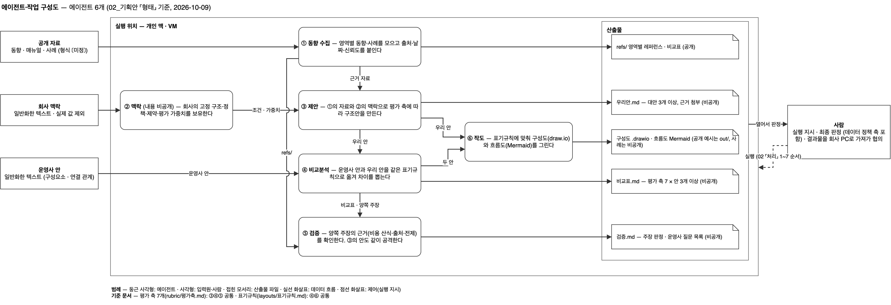
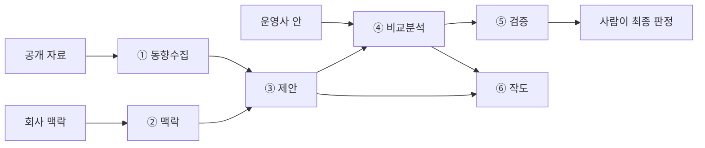

# governed-arch-opinion

외부 운영사가 제안한 인프라 구성안에 **근거를 갖춘 두 번째 의견(second opinion)** 을 내기 위한 AI 에이전트 모음입니다.
데이터 거버넌스·데이터 기획 담당자나 데이터 아키텍트가, 전문 인프라 조직 없이도 구성안을 해석하고 대안을 비교하고 주장의 근거를 확인할 수 있도록 돕습니다.

기준 구조는 AWS Control Tower 랜딩존이며, 회사별 조건만 바꿔 넣으면 어느 조직에서나 쓸 수 있게 설계했습니다.



## 이런 상황에서 씁니다

- 운영사가 그려 온 구성도를 받았는데, 비용이나 대안을 따져 볼 기준이 없을 때
- 운영사가 "이렇게 하는 게 낫다"고 했지만 그 근거를 확인할 방법이 없을 때
- 클라우드 사업자 문서, 레퍼런스 아키텍처, 블로그가 너무 많아 무엇을 믿어야 할지 모를 때
- 데이터 정책(분류·접근·반출·보존·리니지) 관점이 인프라 결정에서 빠지지 않게 하고 싶을 때

## 어떻게 동작하나요

에이전트 여섯 개가 역할을 나눠 일합니다. 우리 안을 만든 에이전트가 스스로를 검증하지 않도록 제안과 검증을 분리했습니다.

| 번호 | 에이전트 | 하는 일 |
|---|---|---|
| ① | 동향수집 | 영역별 최신 동향과 사례를 모으고, 출처·날짜·신뢰도 등급(A~D)을 붙입니다 |
| ② | 맥락 | 회사의 고정 구조·정책·제약·평가 가중치를 담습니다. 내용은 공개하지 않습니다 |
| ③ | 제안 | ①의 자료와 ②의 조건으로 평가 축에 따라 우리 안을 만듭니다 |
| ④ | 비교분석 | 운영사 안과 우리 안을 같은 표기로 옮겨 축별 차이를 정리합니다 |
| ⑤ | 검증 | 양쪽 주장을 사실 / 근거 부족 / 반박으로 판정하고, 운영사에 물을 질문을 뽑습니다 |
| ⑥ | 작도 | 표기 규칙에 맞춰 구성도(draw.io)와 흐름도(Mermaid)를 그립니다 |



## 판단 원칙

이 저장소의 에이전트는 아래 원칙을 따르도록 `CLAUDE.md`에 규칙으로 적혀 있습니다.

1. **근거를 먼저 쓰고, 판정은 그 근거에서만 끌어냅니다.** 결론부터 쓰게 했을 때 근거 없이 판정이 앞서 나가는 문제를 실험으로 확인한 뒤 정한 규칙입니다.
2. **출처마다 신뢰도 등급을 붙입니다.** 공식 문서는 A, 공개 기업 사례는 B, 실무자 블로그는 C, 출처 불명은 D입니다. C 근거만 있으면 '상' 판정을 줄 수 없습니다.
3. **근거가 없으면 추론하지 않고 〔미정〕으로 둡니다.** 무엇이 없어서 판정하지 못했는지도 함께 적습니다.
4. **데이터 정책 축의 최종 판정은 사람이 합니다.** 에이전트는 근거와 제시 판정까지만 씁니다.

평가 축은 비용, 효과, 효율, 동향 적합성, 커스터마이징, 데이터 정책, AI 인프라 적합성의 일곱 가지이며, 축마다의 판정 기준은 [`rubric/평가축.md`](rubric/평가축.md)에 있습니다.

## 시작하기

[Claude Code](https://claude.com/claude-code)에서 이 폴더를 열어 사용합니다.

1. 저장소를 내려받습니다.
   ```bash
   git clone https://github.com/LoveEvaLee/governed-arch-opinion.git
   ```
2. Claude Code에서 이 폴더를 열면 `CLAUDE.md`의 규칙과 `.claude/skills/`의 에이전트 여섯 개가 함께 읽힙니다.
3. 회사 조건을 `private/` 폴더에 적습니다(`맥락.md`, `가중치.md`). 이 폴더는 `.gitignore`로 제외되어 저장소에 올라가지 않습니다.
4. 대화창에서 에이전트를 부릅니다. 예: `/동향수집 ETL·오케스트레이션`, `/작도 두 안 나란히 그려줘`

권한 설정(`.claude/settings.json`)은 원본 자료 폴더(`raw/`) 편집과 파일 삭제를 막고, `git commit`·`git push` 전에는 항상 확인을 묻도록 되어 있습니다.

## 폴더 구성

| 위치 | 내용 |
|---|---|
| `01_페인포인트.md` | 어떤 문제를 풀려는지 — 현재 상황, 요구, 검증 기준 |
| `02_기획안.md` | 에이전트 구성, 평가 축, 범위, 구현 계획 |
| `plan.md` | 진행 체크리스트와 완료 정의 |
| `CLAUDE.md` | 에이전트가 항상 따르는 규칙 7개 |
| `.claude/skills/` | 에이전트 여섯 개의 지침 |
| `rubric/평가축.md` | 평가 축 7개의 정의와 상·중·하 판정 기준 |
| `layouts/표기규칙.md` | 구성도와 흐름도를 같은 표기로 그리기 위한 규칙 |
| `refs/` | 영역별 공개 레퍼런스 |
| `out/` | 공개해도 되는 결과물 (구성도, 채점 예시) |
| `raw/` | 공개·예시 입력 자료 |
| `기록.md` | 단계별 작업 기록 |

## 공개하지 않는 것

회사 맥락, 평가 가중치, 실제 사례와 그 결과물은 `private/`에 두고 저장소에 올리지 않습니다. 회사명·운영사명·실제 값(IP, 호스트명, 계정 ID)은 `private/` 밖에 쓰지 않는 것이 이 저장소의 규칙입니다. `.gitignore`가 1차로 막지만, 마지막 확인은 사람이 합니다.

## 현재 상태

초기 단계입니다. 평가 축, 표기 규칙, 에이전트 구성도까지 만들었고, 에이전트 지침은 대부분 뼈대 상태입니다. 첫 번째 실제 결정(ETL 도구 전환) 한 건을 여섯 에이전트에 끝까지 통과시키는 것이 다음 목표이며, 진행 상황은 [`plan.md`](plan.md)에서 확인할 수 있습니다.

## 라이선스

[MIT License](LICENSE)로 공개합니다. 출처를 밝히면 자유롭게 쓰고 고치고 배포할 수 있습니다.
